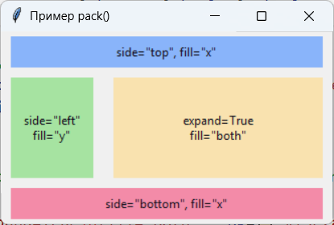
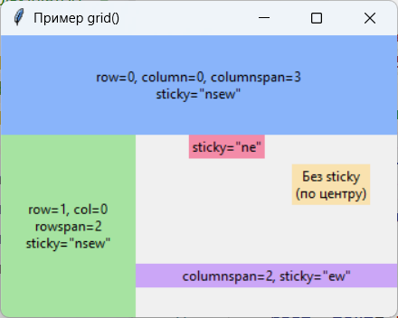
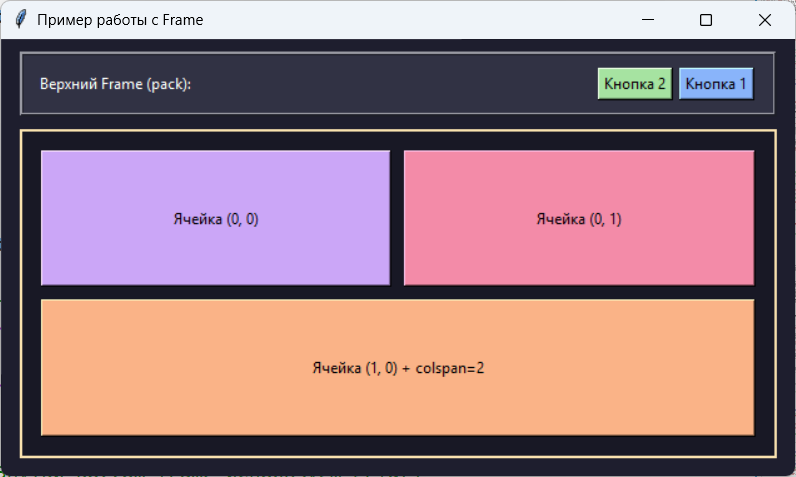

### Позиционирование виджетов в Tkinter

В Tkinter есть три менеджера геометрии (способа размещения элементов в окне): `pack()`, `place()` и `grid()`.

> **Главное правило:** внутри одного контейнера (окна или `Frame`) нельзя смешивать разные менеджеры геометрии (например, использовать одновременно `pack` и `grid` для элементов одного родителя - программа зависнет).

---

### 1. Менеджер `pack()` - упаковка по краям

Ниже - подробный разбор параметров `pack()` и `grid()` с готовыми самодостаточными сниппетами. Каждый пример можно сразу запустить, сделать скриншот и вставить в методичку для ребят.

---

### 1. Параметры менеджера `pack()`

`pack()` работает по принципу «упаковки по краям»: каждый новый виджет прижимается к указанной стороне свободного пространства окна.

| Параметр | Возможные значения | За что отвечает |
| --- | --- | --- |
| **`side`** | `"top"`, `"bottom"`, `"left"`, `"right"` | К какой стороне контейнера прижать элемент (по умолчанию `"top"`). |
| **`fill`** | `"none"`, `"x"`, `"y"`, `"both"` | Растягивание виджета вдоль оси X, Y или на всё доступное пространство. |
| **`expand`** | `True`, `False` | Разрешает ли виджету забирать свободное пустое место при растягивании окна. |
| **`padx`** / **`pady`** | число или кортеж (например `(5, 15)`) | Внешние отступы вокруг виджета в пикселях (слева/справа и сверху/снизу). |
| **`ipadx`** / **`ipady`** | число | Внутренние отступы (увеличивают размер самого виджета изнутри). |

Пример:

```python
import tkinter as tk

root = tk.Tk()
root.title("Пример pack()")
root.geometry("350x280")

# 1. Прижата к верху, растянута по ширине (fill="x")
tk.Label(root, text='side="top", fill="x"', bg="#89b4fa", fg="#11111b").pack(
    side="top", fill="x", padx=10, pady=5, ipady=5
)

# 2. Прижата к низу (side="bottom")
tk.Label(root, text='side="bottom", fill="x"', bg="#f38ba8", fg="#11111b").pack(
    side="bottom", fill="x", padx=10, pady=5, ipady=5
)

# 3. Прижата влево, растянута по высоте (fill="y")
tk.Label(root, text='side="left"\nfill="y"', bg="#a6e3a1", fg="#11111b").pack(
    side="left", fill="y", padx=10, pady=5, ipadx=10
)

# 4. Забирает всё оставшееся место по центру (expand=True, fill="both")
tk.Label(
    root, text='expand=True\nfill="both"', bg="#f9e2af", fg="#11111b"
).pack(expand=True, fill="both", padx=10, pady=5)

root.mainloop()
```



---

### 3. Менеджер `grid()` - табличная сетка

`grid()` делит контейнер на невидимую таблицу из строк и столбцов (нумерация всегда начинается с `0`).

| Параметр | Возможные значения | За что отвечает |
| --- | --- | --- |
| **`row`** / **`column`** | целое число (`0`, `1`, `2`...) | Номер строки и номер столбца, в которую ставится виджет. |
| **`rowspan`** / **`columnspan`** | целое число (`2`, `3`...) | На сколько строк вниз или столбцов вправо объединить ячейки. |
| **`sticky`** | `"n"`, `"s"`, `"e"`, `"w"` или их комбинации (`"nsew"`, `"ew"`) | К какому краю ячейки приклеить виджет (Север, Юг, Восток, Запад). `"nsew"` растягивает на всю ячейку. |
| **`padx`** / **`pady`** | число (например, `5`) | Внешние отступы между соседними ячейками. |
| **`ipadx`** / **`ipady`** | число (например, `10`) | Внутренние отступы внутри кнопки/поля. |

> **Важный нюанс про `grid()`:** По умолчанию столбцы и строки имеют ширину и высоту по размеру самого большого виджета в них. Чтобы сетка растягивалась равномерно на всё окно, у родителя прописывают вес (`weight=1`):
> `root.columnconfigure(номер_столбца, weight=1)` и `root.rowconfigure(номер_строки, weight=1)`.

Пример

```python
import tkinter as tk

root = tk.Tk()
root.title("Пример grid()")
root.geometry("350x250")

# Делаем 3 столбца и 3 строки одинаковыми по размеру
for c in range(3):
  root.columnconfigure(c, weight=1)
for r in range(3):
  root.rowconfigure(r, weight=1)

# 1. Объединение 3 столбцов (columnspan=3) и растягивание (sticky="nsew")
tk.Label(
    root, text='row=0, column=0, columnspan=3\nsticky="nsew"', bg="#89b4fa"
).grid(row=0, column=0, columnspan=3, sticky="nsew")

# 2. Объединение 2 строк вниз (rowspan=2)
tk.Label(
    root, text='row=1, col=0\nrowspan=2\nsticky="nsew"', bg="#a6e3a1"
).grid(row=1, column=0, rowspan=2, sticky="nsew")

# 3. Обычная ячейка, прижата только к верхнему правому углу (sticky="ne")
tk.Label(root, text='sticky="ne"', bg="#f38ba8").grid(
    row=1, column=1, sticky="ne"
)

# 4. Обычная ячейка по центру (без sticky)
tk.Label(root, text="Без sticky\n(по центру)", bg="#f9e2af").grid(
    row=1, column=2
)

# 5. Растянута только по горизонтали (sticky="ew") на 2 столбца
tk.Label(root, text='columnspan=2, sticky="ew"', bg="#cba6f7").grid(
    row=2, column=1, columnspan=2, sticky="ew"
)
''''''
root.mainloop()

```



---

### Вложенные фреймы

**`tk.Frame` (фрейм)** - это виджет-контейнер, своеобразная «коробка» для группировки других элементов интерфейса. Сам по себе он не выполняет никаких действий, но внутрь него можно помещать кнопки, надписи, поля ввода и даже другие фреймы.

#### Зачем нужен `Frame`

* **Совмещение `pack()` и `grid()` в одном окне.** Внутри одного родителя нельзя смешивать менеджеры геометрии. С помощью фреймов эта проблема решается просто: в главном окне фреймы располагаются через `pack()`, а внутри конкретного фрейма кнопки раскладываются по сетке `grid()`.
* **Группировка и сложная вёрстка.** Удобно делить интерфейс на логические блоки (шапка, боковая панель, блок кнопок, строка состояния). Если нужно сдвинуть, скрыть или перекрасить целый блок - достаточно изменить один фрейм, а не каждый виджет по отдельности.
* **Визуальное разделение.** Фрейму можно задать собственный цвет фона и рамку, чтобы аккуратно отделить одну часть программы от другой.

---

### Основные параметры `tk.Frame`

| Параметр | Возможные значения | За что отвечает |
| --- | --- | --- |
| **`bg`** (`background`) | цвет (`"#313244"`, `"gray"`) | Цвет фона внутри фрейма. |
| **`bd`** (`borderwidth`) | число (например, `2`, `4`) | Толщина объёмной рамки в пикселях (по умолчанию `0`). |
| **`relief`** | `"flat"`, `"sunken"`, `"raised"`, `"groove"`, `"ridge"`, `"solid"` | Стиль рамки (плоская, вдавленная, выпуклая и т. д.). Работает, если `bd > 0`. |
| **`padx`** / **`pady`** | число (например, `10`) | Внутренние отступы от краёв фрейма до вложенных в него виджетов. |
| **`width`** / **`height`** | число в пикселях | Желаемая ширина и высота фрейма. |
| **`highlightbackground`** / **`highlightthickness`** | цвет и число (например, `2`) | Цвет и толщина ровной плоской обводки по периметру фрейма. |

> **Важный нюанс про `width` и `height`:** по умолчанию `Frame` автоматически сжимается ровно под размер тех виджетов, которые лежат внутри него, игнорируя заданные `width` и `height`. Чтобы заставить фрейм строго держать указанный размер, нужно отключить автоподстройку методом `frame.pack_propagate(False)` (или `frame.grid_propagate(False)`).

---

В этом примере главное окно разделено на два фрейма с помощью `pack()`. Внутри верхнего фрейма виджеты лежат в ряд через `pack()`, а внутри нижнего - по сетке `grid()`.

```python
import tkinter as tk

root = tk.Tk()
root.title("Пример работы с Frame")
root.geometry("360x260")
root.config(bg="#1e1e2e")

# 1. Верхний фрейм с выпуклой рамкой (relief="ridge")
top_frame = tk.Frame(
    root,
    bg="#313244",
    bd=3,
    relief="ridge",
    padx=10,
    pady=10,
)
top_frame.pack(fill="x", padx=15, pady=10)

# Внутри top_frame используем pack(side="left")
tk.Label(top_frame, text="Верхний Frame (pack):", bg="#313244", fg="white").pack(
    side="left"
)
tk.Button(top_frame, text="Кнопка 1", bg="#89b4fa").pack(side="right", padx=5)
tk.Button(top_frame, text="Кнопка 2", bg="#a6e3a1").pack(side="right")

# 2. Нижний фрейм с цветной плоской обводкой (highlightthickness)
bottom_frame = tk.Frame(
    root,
    bg="#181825",
    highlightbackground="#f9e2af",
    highlightthickness=2,
    padx=10,
    pady=10,
)
bottom_frame.pack(fill="both", expand=True, padx=15, pady=(0, 15))

# Настраиваем сетку внутри bottom_frame
for c in range(2):
    bottom_frame.columnconfigure(c, weight=1)
for r in range(2):
    bottom_frame.rowconfigure(r, weight=1)

# Внутри bottom_frame используем grid()
tk.Button(bottom_frame, text="Ячейка (0, 0)", bg="#cba6f7").grid(
    row=0, column=0, sticky="nsew", padx=5, pady=5
)
tk.Button(bottom_frame, text="Ячейка (0, 1)", bg="#f38ba8").grid(
    row=0, column=1, sticky="nsew", padx=5, pady=5
)
tk.Button(bottom_frame, text="Ячейка (1, 0) + colspan=2", bg="#fab387").grid(
    row=1, column=0, columnspan=2, sticky="nsew", padx=5, pady=5
)

root.mainloop()

```

---

### Поле ввода `tk.Entry`

Для отображения вводимого выражения используется виджет `tk.Entry`. Основные методы работы с ним:

```python
# Создание поля ввода
self.entry = tk.Entry(self.root, font=("Arial", 20), justify="right")

# 1. Получить текущий текст из поля
text = self.entry.get()

# 2. Добавить символ в конец поля (tk.END)
self.entry.insert(tk.END, "5")

# 3. Полностью очистить поле (от 0-го символа до конца)
self.entry.delete(0, tk.END)

```

```python
self.buttons_frame = tk.Frame(self.root, bg="#1e1e2e")
    self.buttons_frame.pack(fill="both", expand=True, padx=5, pady=5)

    # Настройка растягивания сетки внутри buttons_frame
    for i in range(5):
      self.buttons_frame.rowconfigure(i, weight=1)
    for j in range(4):
      self.buttons_frame.columnconfigure(j, weight=1)
```

---

### Практическое задание: Калькулятор

Положите выданный файл `calculate.py` рядом с вашим скриптом. В нём уже реализована функция `calculate(expression: str) -> str`, которая принимает строку с математическим выражением (поддерживает `+`, `-`, `*`, `/`, `^`, скобки и унарные знаки) и возвращает строку с ответом или `"err"` при ошибке.

**Ваша задача:** написать графический интерфейс калькулятора в классе `CalculatorApp`.

#### Технические требования:

1. **Импорт:** Подключите функцию вычисления в начале файла:
```python
from calculate import calculate

```

[Ссылка на calculate.py](Функции/calculate.py)

2. **Экран (поле ввода):** Разместите сверху виджет `tk.Entry` с выравниванием текста по правому краю (`justify="right"`).
3. **Сетка кнопок:** Под полем ввода создайте сетку кнопок с помощью `.grid()` (или вложенного фрейма с `.grid()`):
   * Цифры: `0`–`9` и точка `.`
   * Операции: `+`, `-`, `*`, `/`, `^`, `(`, `)`
   * Управляющие кнопки: `C` (полная очистка поля) и `=` (вычисление результата).
4. **Логика нажатия:**
   * При нажатии на цифры и знаки операций символ должен добавляться в конец `Entry`.
   * При нажатии на `C` поле `Entry` полностью очищается.
   * При нажатии на `=` программа забирает строку из `Entry`, передаёт её в функцию `calculate()`, очищает поле и записывает туда полученный ответ.

---

### Дополнительные задания
1. **Кнопка Backspace (`⌫`):** Добавьте кнопку удаления только одного последнего символа из поля ввода. Подсказка: получить длину текста можно через `len(self.entry.get())`, а удалить последний символ через `self.entry.delete(length - 1, tk.END)`.
2. **Ввод с клавиатуры:** Привяжите клавишу `Enter` (`"<Return>"`) к вычислению результата (`=`), а клавишу `Escape` - к очистке поля (`C`).
3. **Защита от `"err"`:** Если на экране уже написано `"err"`, сделайте так, чтобы при нажатии на любую новую цифру поле сначала автоматически очищалось, а не дописывало цифры в конец слова `"err5"`.